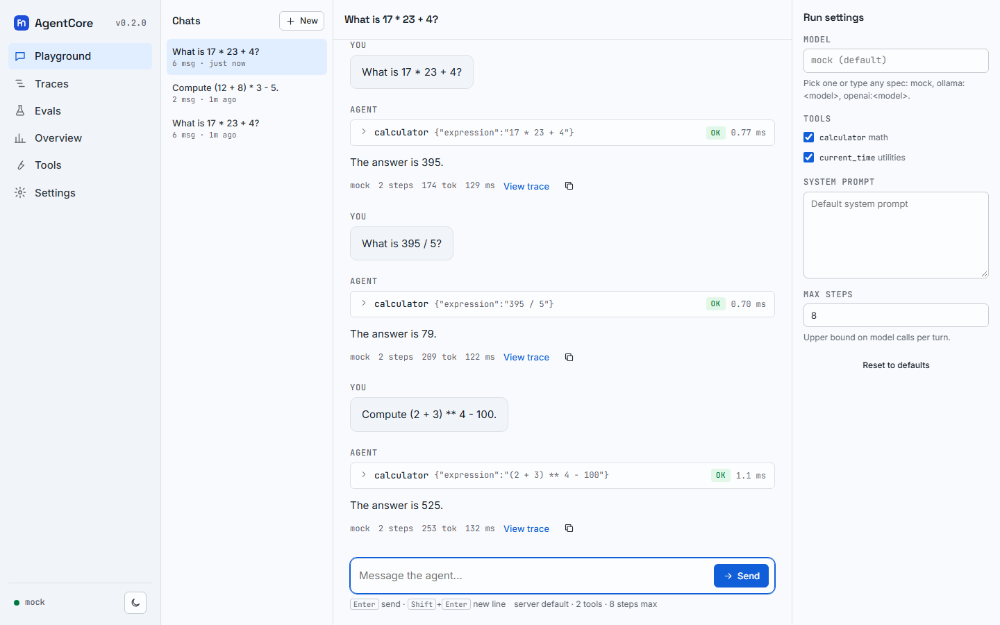
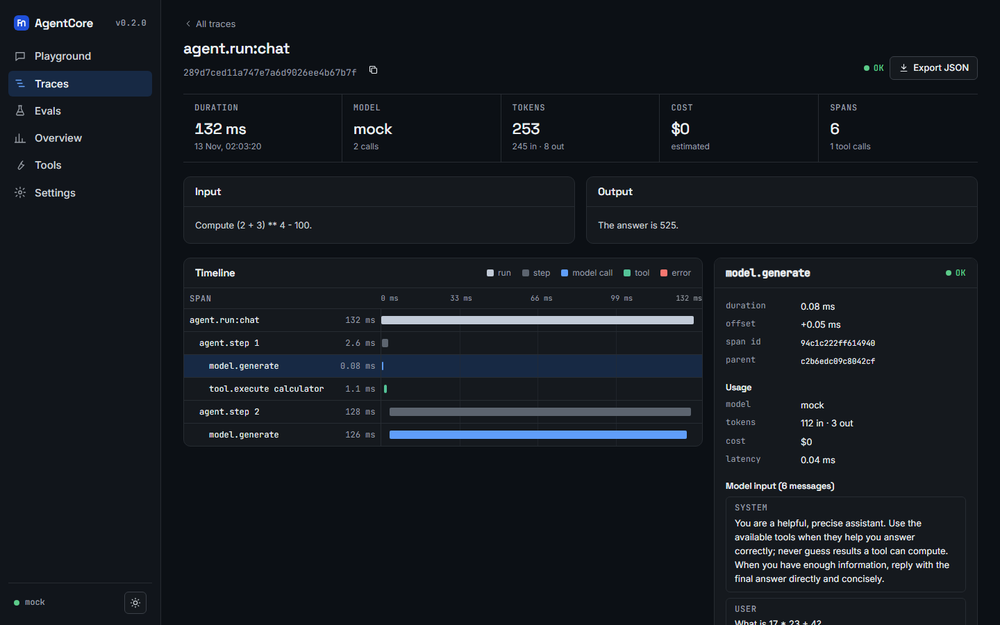
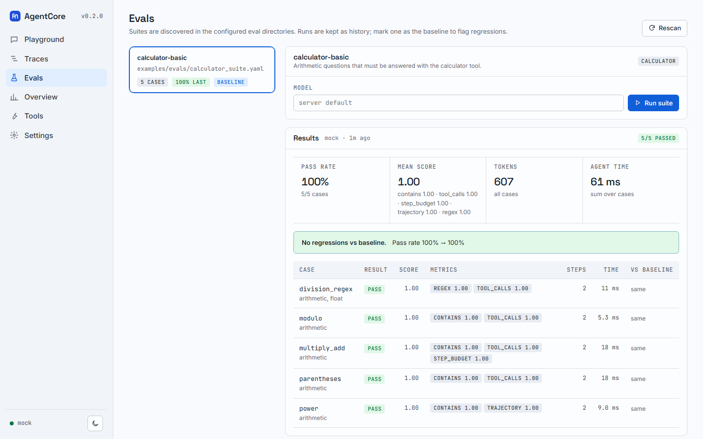
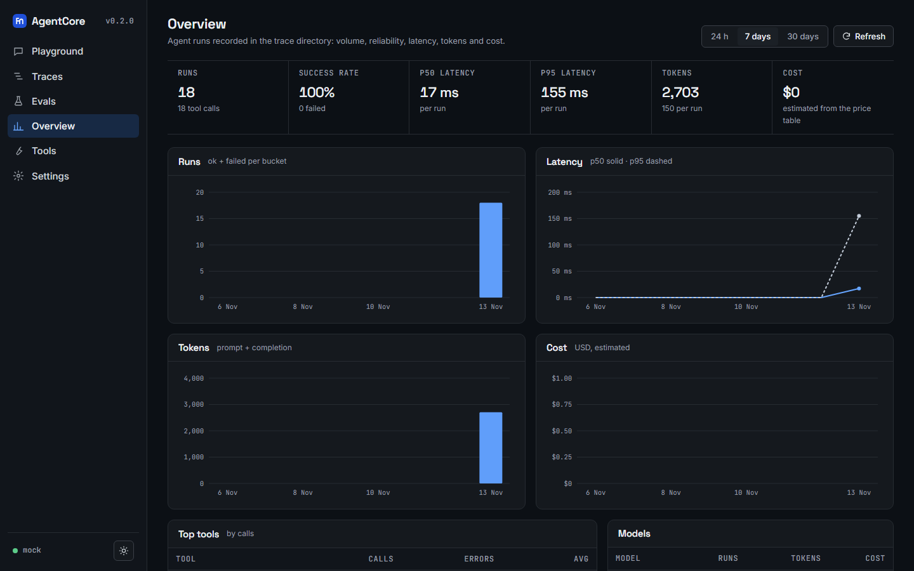

# AgentCore

**A from-scratch agentic AI platform in plain Python.** ReAct runtime with native tool calling, a
type-safe tool framework with sandboxed execution, an evaluation harness with deterministic replay,
RAG with hybrid search, vector indexes (HNSW / IVF / PQ) written from scratch, a workflow-graph engine
with human-in-the-loop and saga compensation, multi-agent collaboration, and built-in observability.

No LangChain, no LangGraph, no AutoGen, no CrewAI. Runtime dependencies: `httpx`, `numpy`, `pyyaml`.

[](https://github.com/Manas-thakur/agentcore/actions/workflows/ci.yml)


Everything runs **offline** out of the box: a deterministic rule-based `mock` model drives the
examples, tests and CI. Point the same code at a local model (Ollama) or any OpenAI-compatible
server (OpenAI, vLLM, LM Studio, Groq, llama.cpp, ...) by changing one flag.

`agentcore serve` adds a web app (streaming chat playground, trace waterfalls, eval runs with
baselines, an overview of latency/tokens/cost, a tool tester) and an **OpenAI-compatible
`/v1/chat/completions` endpoint** backed by the agent, so existing OpenAI clients can talk to it.

| Playground | Trace waterfall |
|---|---|
|  |  |
| **Evals** | **Overview** |
|  |  |

## Features

- **Agent runtime** - ReAct loop with native tool calling, parallel tools, streaming, memory tiers,
  reflection, stuck detection, timeouts; Ollama, any OpenAI-compatible server, or offline `mock`.
- **Tools** - `@tool` turns typed Python functions into JSON-Schema tools with validation, retries,
  rate limits and a subprocess sandbox.
- **Web app** (`agentcore serve`) - multi-turn chat over SSE with server-side sessions, inline tool
  cards, stop button and per-answer trace links; searchable traces with a span waterfall, model
  inputs/outputs, tokens and cost; eval suites run in the background with history and regression
  highlighting; KPI overview; tool "try it" forms; light/dark themes; works at phone width.
- **API** - one-shot `/v1/agent`, streaming `/api/chat`, OpenAI-compatible `/v1/chat/completions`
  (with `stream: true`), optional API key, configurable CORS, request size limits.
- **Evaluation** - YAML suites, trajectory and tool-call matching, LLM-as-judge, record/replay
  cassettes, baselines and regression gates for CI.
- **RAG, vector indexes, workflow graphs, multi-agent, observability** - all from scratch, all tested.
- **Project tooling** - `agentcore init` scaffolds a runnable project, `agentcore doctor` checks the
  environment, `agentcore.toml` holds defaults.

---

## Philosophy

Build every component of an agentic AI system from scratch, so that someone reading the code can
understand exactly how production agent systems work under the hood: the agent loop, the tool
registry, memory, the evaluation harness, the orchestration graph and the observability layer. Each
component is independently usable and tested.

Most AI engineers know how to call an LLM API and chain a few framework calls together. Far fewer
understand how a ReAct loop actually works, how to generate JSON Schema from Python functions, how to
implement BM25 + dense hybrid search, how HNSW navigates a graph, how a workflow engine checkpoints
and compensates, or how to evaluate non-deterministic agents deterministically. This repository is an
implementation of all of those.

### Development principles

1. **No framework dependencies for core logic.** Libraries are used for transport (`httpx`), math
   (`numpy`) and parsing (`pyyaml`) - never for architecture.
2. **Every component is independently testable.** LLM calls are mocked or replayed; the full test
   suite runs offline in seconds.
3. **Deterministic where possible.** Scripted/mock models and recorded "cassettes" make agent runs
   reproducible.
4. **Observability is first-class.** Agent runs, model calls, tool calls, graph nodes and A2A
   messages all emit spans, metrics and cost data.
5. **Model-agnostic.** `mock`, `ollama:<model>` or `openai:<model>` - one string.

## What's inside

| Module | What it implements | Key types |
|---|---|---|
| `agentcore.runtime` | ReAct loop with native tool calling, parallel tool execution, max-steps/timeout guards, stuck detection, reflection hooks, token streaming, event callbacks; memory tiers; context-window budgeting | `Agent`, `create_model`, `OllamaClient`, `OpenAICompatibleClient`, `MockModel`, `ScriptedModel`, `BufferMemory`, `SlidingWindowMemory`, `SummarizingMemory`, `LongTermMemory`, `HybridMemory`, `ContextManager` |
| `agentcore.tools` | `@tool` -> JSON Schema from type hints + Google/NumPy/Sphinx docstrings (Optional, Union, Literal, Enum, list/dict, dataclass, TypedDict, pydantic); validation with type coercion; execution engine with timeouts, retries, rate limits, hooks; subprocess sandbox; built-ins | `tool`, `ToolRegistry`, `ExecutionEngine`, `SubprocessSandbox`, `calculator`, `python_exec`, `file_tools`, `http_get`, `web_search` |
| `agentcore.eval` | YAML/JSON suites, trajectory recording, exact/contains/regex, tool-call and trajectory matching, step budgets, LLM-as-judge, record/replay cassettes, baseline regression detection, markdown reports | `EvalSuite`, `EvalRunner`, `TrajectoryRecorder`, `LLMAsJudge`, `Cassette`, `compare` |
| `agentcore.rag` | Loaders (txt/md/html/jsonl/dirs), fixed/recursive/sentence/markdown-aware chunkers, BM25, hybrid retrieval with reciprocal rank fusion, lexical and MMR rerankers, citation tracking and verification | `RAGPipeline`, `BM25`, `HybridRetriever`, `MarkdownChunker`, `CitationTracker` |
| `agentcore.index` | Flat (exact), HNSW, IVF (k-means++), scalar (int8) and product quantization with ADC, metadata filters, deletes, save/load | `FlatIndex`, `HNSWIndex`, `IVFIndex`, `SQIndex`, `PQIndex`, `load_index` |
| `agentcore.graph` | State-graph engine: nodes, static/conditional edges, parallel fan-out and joins, per-key reducers, retries, fallbacks, checkpoints (memory/file), `interrupt()`/resume for human-in-the-loop, saga compensation, subgraphs, Mermaid export | `StateGraph`, `interrupt`, `FileCheckpointer` |
| `agentcore.agents` | Researcher, Coder (sandboxed execution), Reviewer, Planner; in-process A2A message bus (direct, broadcast, topics, request/response); manager-worker, pipeline and peer-review patterns | `ResearcherAgent`, `CoderAgent`, `ReviewerAgent`, `PlannerAgent`, `MessageBus`, `ManagerWorker`, `Pipeline` |
| `agentcore.obs` | Span tracer (contextvar-based, async-safe) with optional OpenTelemetry mirroring, JSONL trace store, Prometheus-style metrics, JSON logging with trace ids, per-model cost tracking | `configure_tracing`, `JSONLTraceStore`, `MetricsCollector`, `CostTracker` |
| `agentcore.server` | FastAPI app: agent API, OpenAI-compatible chat completions, SSE chat with sessions, trace/eval/overview APIs, API-key auth, and the no-build web app | `create_app` |
| `agentcore.research` | Showcase "technical researcher": cited markdown report + trace + cost files | `research` |

### How it compares

| Aspect | Typical project | AgentCore |
|--------|----------------|-----------|
| Agent loop | Framework agent executor | Custom ReAct loop: native tool calls, parallel tools, reflection, stuck detection, streaming |
| Tools | Framework tool decorator | `@tool` -> JSON Schema -> validated, retried, sandboxed execution |
| Memory | Conversation buffer | Buffer, sliding window, summarizing, long-term vector memory, hybrid |
| Evaluation | Manual testing | Trajectory matching, LLM-as-judge, deterministic replay, regression gates in CI |
| RAG | Framework retrieval chain | Chunking, BM25 + dense hybrid search, RRF, rerank, verified citations |
| Vector index | FAISS/Pinecone wrapper | HNSW, IVF, Flat, SQ8, PQ implemented with numpy |
| Orchestration | LangGraph | State-graph engine with HITL interrupts, checkpoints, compensation, subgraphs |
| Observability | None | Spans (+ optional OpenTelemetry), metrics, structured logs, cost, trace dashboard |

## Installation

Requires Python 3.10+.

```bash
# Library + CLI
pip install "git+https://github.com/Manas-thakur/agentcore"

# With the HTTP server / web app (FastAPI + uvicorn)
pip install "agentcore[server] @ git+https://github.com/Manas-thakur/agentcore"

# Everything (server, OpenTelemetry, pydantic support)
pip install "agentcore[all] @ git+https://github.com/Manas-thakur/agentcore"
```

Releases also ship as a wheel on the [GitHub Releases](https://github.com/Manas-thakur/agentcore/releases)
page and as a container image:

```bash
docker run -p 8000:8000 -e AGENTCORE_MODEL=mock ghcr.io/manas-thakur/agentcore:latest
```

(PyPI publishing is wired up in the release workflow but switched off until a trusted publisher is
configured - see [Releasing](#releasing).)

### Development setup (uv)

```bash
git clone https://github.com/Manas-thakur/agentcore.git
cd agentcore
uv sync --all-extras          # or: make install
uv run pytest -q              # or: make test
uv run ruff check .           # or: make lint
```

`make` targets (`install`, `test`, `lint`, `format`, `eval`, `examples`, `serve`, `docker`, `check`)
are thin wrappers around the `uv` commands; on Windows without `make`, run the commands directly.

## Quick start (offline, no LLM needed)

Every command below works without any model server, using the deterministic `mock` model.
Inside a clone, prefix commands with `uv run` (or activate `.venv`).

```bash
# Start a new project: agent.py with a sample @tool, evals/basic.yaml, agentcore.toml, .env.example
agentcore init my-agent && cd my-agent
python agent.py --model mock "What is the capital of France?"
agentcore eval --suite evals/basic.yaml --model mock
agentcore serve --model mock          # web app at http://127.0.0.1:8000
agentcore doctor                      # environment + model reachability check
```

Or explore the repository's own examples:

```bash
# A tool-using ReAct agent
agentcore run examples/calculator_agent.py --model mock

# Ask one question from the CLI (or drop -p for an interactive chat)
agentcore chat --model mock -p "What is 17 * 23 + 4?"

# RAG over the sample docs with hybrid search and citations
python examples/rag_qa.py --model mock "How does reciprocal rank fusion work?"

# Workflow graph: fan-out/join, loop, human approval, compensation
python examples/workflow_graph.py
python examples/workflow_graph.py --fail

# Planner -> Researcher / Coder -> Reviewer over the A2A bus
python examples/multi_agent.py --model mock

# Run the eval suite (exit code 1 on failures/regressions)
agentcore eval --suite examples/evals/calculator_suite.yaml --model mock

# Research a topic over a local corpus -> report.md, report.trace.json, report.cost.json
agentcore research "How does HNSW search work?" --docs examples/data --model mock

# Inspect traces written by the runs above
agentcore traces list
agentcore traces show <trace-id-prefix>

# Web app + API at http://127.0.0.1:8000 (needs the [server] extra)
agentcore serve --model mock
curl -s -X POST http://127.0.0.1:8000/v1/agent -H "Content-Type: application/json" \
     -d '{"input": "What is 2 ** 10?"}'

# Any OpenAI client works against the agent
curl -s http://127.0.0.1:8000/v1/chat/completions -H "Content-Type: application/json" \
     -d '{"model": "agentcore", "messages": [{"role": "user", "content": "What is 2 ** 10?"}]}'
```

```python
from openai import OpenAI   # pip install openai

client = OpenAI(base_url="http://127.0.0.1:8000/v1", api_key="unused-unless-AGENTCORE_API_KEY-is-set")
for chunk in client.chat.completions.create(
    model="agentcore", messages=[{"role": "user", "content": "What is 17 * 23?"}], stream=True
):
    print(chunk.choices[0].delta.content or "", end="")
```

### Using a real model

```bash
# Ollama (https://ollama.com): pull a model with tool-calling support first
ollama pull qwen2.5:7b
agentcore chat --model ollama:qwen2.5:7b
python examples/calculator_agent.py --model ollama:qwen2.5:7b "What is 2**20 - 1?"

# OpenAI
export OPENAI_API_KEY=sk-...
agentcore chat --model openai:gpt-4o-mini

# Any OpenAI-compatible server (vLLM, LM Studio, llama.cpp, Groq, ...)
export OPENAI_BASE_URL=http://localhost:8000/v1   # e.g. vLLM
agentcore chat --model openai:Qwen/Qwen2.5-7B-Instruct
```

The examples default to `--model auto`: Ollama is used if it is reachable and
`AGENTCORE_OLLAMA_MODEL` (default `qwen2.5:7b`) is pulled; otherwise they fall back to `mock` and say so.

## Usage by module

### Runtime: agents, models, memory

```python
from agentcore import Agent, create_model, tool
from agentcore.runtime import SlidingWindowMemory
from agentcore.tools import calculator

@tool
def get_weather(city: str, unit: str = "celsius") -> str:
    """Get the current weather for a city.

    Args:
        city: City name, e.g. "Pune".
        unit: "celsius" or "fahrenheit".
    """
    return f"22 degrees {unit} and sunny in {city}"

agent = Agent(
    create_model("mock"),                 # or "ollama:qwen2.5:7b", "openai:gpt-4o-mini"
    tools=[calculator, get_weather],
    memory=SlidingWindowMemory(max_turns=5),
    max_steps=8,
)
agent.on(lambda ev: print(ev.type, ev.data.get("name", "")))   # event callbacks
result = agent.run_sync("What is 17 * 23 + 4?")
print(result.output, result.stop_reason, result.usage.total_tokens)
```

`await agent.run(...)` is the async API; `async for ev in agent.stream(task)` yields events (including
tokens when `stream=True`). Other options: `reflect_every=N` (periodic LLM self-reflection),
`reflection_hook=fn`, `stuck_threshold`, `timeout_seconds`, `context_window` (enables truncation via
`ContextManager`), `parallel_tool_calls`. `agent.as_tool()` turns an agent into a tool for another agent.

Memory tiers: `BufferMemory` (message/token budget), `SlidingWindowMemory` (last N turns),
`SummarizingMemory(model)` (folds old turns into a structured summary), `LongTermMemory` (vector
recall with importance scores), `HybridMemory` (window + long-term). All support `save()`/`load()`.

### Tools: schema generation, validation, sandbox

```python
from dataclasses import dataclass
from typing import Literal
from agentcore.tools import tool, ToolRegistry, ExecutionEngine, SubprocessSandbox, SandboxConfig

@dataclass
class Point:
    x: float
    y: float = 0.0

@tool(timeout=5, retries=1, category="geometry")
def distance(a: Point, b: Point, metric: Literal["euclid", "manhattan"] = "euclid") -> float:
    """Distance between two points.

    Args:
        a: First point.
        b: Second point.
        metric: Distance metric.
    """
    if metric == "manhattan":
        return abs(a.x - b.x) + abs(a.y - b.y)
    return ((a.x - b.x) ** 2 + (a.y - b.y) ** 2) ** 0.5

print(distance.parameters)              # JSON Schema (dataclass -> nested object, Literal -> enum)
engine = ExecutionEngine(ToolRegistry([distance]))
import asyncio
res = asyncio.run(engine.execute("distance", {"a": {"x": "3"}, "b": {"x": 0, "y": 4}}))
print(res.success, res.output)          # True 5.0  ("3" was coerced to 3.0)

print(SubprocessSandbox(SandboxConfig(timeout_seconds=5)).run("print(sum(range(10)))").stdout)
```

Built-ins: `calculator` (AST-based, no `eval`), `python_exec` (sandboxed subprocess), `read_file` /
`write_file` / `list_files` (workspace-scoped, path-traversal safe), `http_get`, `web_search`
(DuckDuckGo HTML), `current_time`. The sandbox is best-effort isolation (isolated interpreter, temp dir,
timeout, POSIX resource limits, no network, optional import allow-list) - use containers for untrusted
multi-tenant code.

### Eval: suites, trajectories, replay, regressions

```yaml
# examples/evals/calculator_suite.yaml (excerpt)
name: calculator-basic
agent:
  tools: [calculator]
  max_steps: 5
cases:
  - name: multiply_add
    input: "What is 17 * 23 + 4?"
    expected_output: "395"            # match: contains (default) | exact | regex
    expected_tool_calls:
      - tool: calculator
        args: {expression: "17 * 23 + 4"}
    max_steps: 3
```

```python
from agentcore.eval import EvalRunner, load_suite, compare

suite = load_suite("examples/evals/calculator_suite.yaml")
report = EvalRunner("mock", record_to="cassette.json").run_suite_sync(suite)
print(report.to_markdown())

replayed = EvalRunner(replay_from="cassette.json").run_suite_sync(suite)   # no model needed
print(compare(report, replayed).has_regressions)                            # False
```

CLI: `agentcore eval --suite S --model M [--baseline base.json --save-baseline] [--record c.json |
--replay c.json] [--judge-model ollama:qwen2.5:7b] [--output r.json --markdown r.md]`.

### RAG: hybrid search with citations

```python
from agentcore import create_model
from agentcore.index import HNSWIndex
from agentcore.rag import RAGPipeline, MarkdownChunker, HashingEmbedder

emb = HashingEmbedder(256)        # offline; or OllamaEmbedder("nomic-embed-text"), OpenAIEmbedder()
rag = RAGPipeline(embedder=emb, index=HNSWIndex(256), chunker=MarkdownChunker(600),
                  model=create_model("mock"), k=3)
rag.ingest("examples/data")
answer = rag.answer_sync("What does ef_search control?")
print(answer.format())            # answer text with [n] citations + verified sources
search_tool = rag.as_tool("search_docs")   # give retrieval to an agent
```

### Vector indexes

```python
import numpy as np
from agentcore.index import FlatIndex, HNSWIndex, IVFIndex, PQIndex, load_index, recall_at_k

x = np.random.default_rng(0).normal(size=(2000, 64)).astype("float32")
ids = [f"v{i}" for i in range(len(x))]
flat, hnsw = FlatIndex(64), HNSWIndex(64, M=16, ef_construction=200, ef_search=64)
flat.add(x, ids); hnsw.add(x, ids)
truth = [[r.id for r in flat.search(q, 10)] for q in x[:20]]
approx = [[r.id for r in hnsw.search(q, 10)] for q in x[:20]]
print(recall_at_k(truth, approx, 10))
hnsw.save("hnsw.npz"); same = load_index("hnsw.npz")
```

### Workflow graphs

```python
from agentcore.graph import StateGraph, START, END, append, interrupt

g = StateGraph("review", reducers={"notes": append})
g.add_node("search_a", lambda s: {"notes": "A"})
g.add_node("search_b", lambda s: {"notes": "B"})
g.add_node("approve", lambda s: {"ok": interrupt({"question": "Ship it?"}) == "yes"})
g.add_node("ship", lambda s: {"shipped": True}, compensate=lambda s: print("rollback"))
g.add_edge(START, ["search_a", "search_b"])          # parallel fan-out
g.add_edge(["search_a", "search_b"], "approve")      # join
g.add_conditional_edges("approve", lambda s: "yes" if s["ok"] else "no", {"yes": "ship", "no": END})
app = g.compile()

r = app.run_sync({})                 # -> status "interrupted", r.interrupt["payload"]
r = app.resume_sync(r.thread_id, "yes")
print(r.status, r.state)             # completed {'notes': [...], 'ok': True, 'shipped': True}
print(g.to_mermaid())
```

### Multi-agent

```python
import asyncio
from agentcore import create_model
from agentcore.agents import ManagerWorker, PlannerAgent, ResearcherAgent, CoderAgent, ReviewerAgent
from agentcore.rag import RAGPipeline

model = create_model("mock")
kb = RAGPipeline(); kb.ingest("examples/data")
team = ManagerWorker(PlannerAgent(model), {
    "researcher": ResearcherAgent(model, knowledge_base=kb),
    "coder": CoderAgent(model),
    "reviewer": ReviewerAgent(model),
})
result = asyncio.run(team.run("Research HNSW and compute 2**10, then review the results"))
print(result.output)
```

### Observability

```python
from agentcore.obs import configure_tracing, get_metrics, CostTracker

configure_tracing(".agentcore/traces", use_otel=False)   # JSONL spans; use_otel=True mirrors to OpenTelemetry
costs = CostTracker()                                     # pass cost_tracker=costs to Agent / agents
# ... run agents ...
print(get_metrics().export_prometheus())
```

Spans: `agent.run:<name>` > `agent.step` > `model.generate` (tokens, cost, latency) / `tool.execute`;
`graph.run:<name>` > `graph.node:<node>`; `a2a.deliver`. With `use_otel=True` and the `otel` extra
installed, every span is mirrored to the OpenTelemetry API so any configured exporter (OTLP, Jaeger,
Tempo, ...) receives it. The web app served by `agentcore serve` reads the same JSONL files.
Model spans also record the (size-bounded) prompt messages and the response, so the trace view can
show exactly what the model saw; pass `trace_content=False` to `Agent` to turn that off.

## Web app

`agentcore serve` serves a no-build web app (plain HTML/CSS/ES modules, no CDN scripts) next to the API:

| Page | What it does |
|---|---|
| **Playground** | Multi-turn chat streamed over SSE. Sessions live on the server (memory + transcript, persisted under the state dir). Tool calls render inline as expandable cards with arguments, result, duration and errors. Model picker (from `/v1/models` or free text), per-tool toggles, system prompt, max steps, a Stop button, and a "View trace" link on every answer. Markdown answers are rendered with an escape-first sanitizer. |
| **Traces** | Search and filter by text, status, model, kind (agent / eval) and date. The detail view shows a nested span waterfall with duration bars, span attributes, model inputs/outputs, tokens and cost, and exports the trace as JSON. |
| **Evals** | Lists suites from the configured eval dirs, runs one in the background with progress polling, shows per-case scores and metric breakdowns, keeps a run history, and compares each run with a chosen baseline (regressions highlighted). |
| **Overview** | Runs, success rate, p50/p95 latency, tokens and cost for 24 h / 7 d / 30 d, with charts over time, top tools by calls and errors, and models. |
| **Tools** | Every enabled tool with its JSON Schema and a generated "try it" form (or raw JSON) that invokes it directly; each invocation is traced. |
| **Settings** | Theme (system / light / dark), the API key stored in this browser, and the server's effective configuration. |

## HTTP API

| Method + path | Description |
|---|---|
| `GET /health` | Liveness, version, default model, enabled tools, whether auth is on (always public) |
| `GET /v1/models` | OpenAI-style model list: default model, `models` from config, `mock`, local Ollama models |
| `POST /v1/agent` | Run once: `{"input": "..."}` or `{"messages": [...]}`; optional `model`, `tools`, `system_prompt`, `max_steps`, `session_id` |
| `POST /v1/chat/completions` | OpenAI-compatible; `model` is `agentcore` (server default) or a spec like `mock` / `ollama:<m>`; supports `stream: true` and `stream_options.include_usage`; the agent runs the server's tools; the response adds an `agentcore` object with `trace_id` and tool calls |
| `POST /api/chat` | Streaming chat turn (SSE). Body: `message`, optional `session_id`, `model`, `tools`, `system_prompt`, `max_steps`. Events: `session`, `run_start` (with `trace_id`), `step_start`, `token`, `model_response`, `tool_start`, `tool_end`, `reflection`, `final`, then `done`, `stopped` or `error` |
| `GET/POST /api/sessions`, `GET/DELETE /api/sessions/{id}`, `POST /api/sessions/{id}/stop` | Session list/create, transcript + memory, delete, cancel the running turn |
| `GET /api/traces` | Trace summaries; query `q`, `status`, `model`, `kind=agent\|eval`, `since`, `until` (epoch or ISO), `limit`, `offset`; total in `X-Total-Count` |
| `GET /api/traces/facets`, `GET /api/traces/{id}`, `GET /api/traces/{id}/export` | Filter values; summary + spans (id or unique prefix); JSON download |
| `GET /api/overview?days=7` | KPIs, time series, top tools, models, recent failures |
| `GET /api/tools`, `POST /api/tools/{name}/invoke` | Enabled tools with schemas; invoke with `{"arguments": {...}}` |
| `GET /api/evals/suites` | Suites discovered in the eval dirs (with last run and baseline) |
| `POST /api/evals/runs`, `GET /api/evals/runs[?suite=]`, `GET /api/evals/runs/{id}`, `POST /api/evals/runs/{id}/baseline` | Start a background run (`{"suite": path-or-name, "model": ...}` -> 202), history, progress/results with diff vs baseline, set baseline |
| `GET /api/config` | Effective configuration (never includes secrets) |
| `GET /metrics` | Prometheus text format |
| `GET /docs` | Interactive OpenAPI docs |

**Security.** Set `AGENTCORE_API_KEY` to require `Authorization: Bearer <key>` (or `X-API-Key`) on
every API route; the web app shell and `/health` stay public and the browser prompts for the key
once. CORS is off unless you list origins (`--cors-origins`, `AGENTCORE_CORS_ORIGINS` or
`[server].cors_origins`). Request bodies over 1 MiB are rejected with 413 (`max_body_kb`). Only
`calculator` and `current_time` are enabled by default - think twice before exposing `python_exec`
or the file tools on a network, and always set an API key when binding to a non-loopback address.

## CLI reference

| Command | Description |
|---|---|
| `agentcore init [DIR] [--name N] [--force]` | Scaffold a project (agent.py with a sample `@tool`, `evals/basic.yaml`, `agentcore.toml`, `.env.example`, README) that runs offline with `--model mock` |
| `agentcore doctor [--model M] [--ping]` | Check Python, extras, config, trace dir, tool modules, eval dirs, Ollama / OpenAI-compatible reachability (`--ping` sends one tiny request); exit 1 on failures |
| `agentcore run SCRIPT [ARGS...]` | Run a Python script (e.g. an example) with arguments |
| `agentcore chat [--model M] [--tools a,b] [-p PROMPT] [--stream] [-v]` | Interactive or one-shot chat with a tool-using agent (sliding-window memory) |
| `agentcore eval --suite PATH [--model M] [...]` | Run an eval suite; options for baselines, regression threshold, record/replay, LLM judge, reports, `--fail-under` |
| `agentcore traces list [--limit N]` / `agentcore traces show ID [--json]` | Inspect stored traces (`--dir` before the subcommand to change the directory) |
| `agentcore serve [--host H] [--port P] [--model M] [--tools a,b] [--cors-origins O]` | Web app + HTTP API (requires `[server]`) |
| `agentcore research TOPIC (--docs DIR \| --web) [--out report.md]` | Researcher agent; writes report, trace and cost JSON |
| `agentcore tools [--schema]` | List built-in and configured custom tools and their JSON Schemas |

Every command accepts `--config PATH` (before the subcommand); otherwise `./agentcore.toml` is used
when present.

## Configuration

Settings come from (highest priority first) CLI flags, environment variables, `agentcore.toml`,
then built-in defaults. `agentcore init` writes a commented `agentcore.toml`:

```toml
model = "mock"                                   # default model spec
models = ["ollama:qwen2.5:7b"]                   # extra entries for the web UI model picker
tools = ["calculator", "current_time", "lookup_fact"]
tool_modules = ["agent.py"]                      # .py files or modules defining @tool functions
trace_dir = ".agentcore/traces"                  # relative paths resolve against this file
eval_dirs = ["evals"]
# data_dir = ".agentcore"                        # sessions + eval history (default: trace_dir/..)
# system_prompt = "You are ..."

[server]
host = "127.0.0.1"
port = 8000
cors_origins = []
max_body_kb = 1024
```

| Setting | `agentcore.toml` | Environment | Default |
|---|---|---|---|
| Default model | `model` | `AGENTCORE_MODEL` | `auto` |
| Enabled tools | `tools` | `AGENTCORE_TOOLS` (comma-separated) | `calculator,current_time` (+ custom tools) |
| Custom tool modules | `tool_modules` | - | none |
| Trace directory | `trace_dir` | `AGENTCORE_TRACE_DIR` | `.agentcore/traces` |
| State directory (sessions, eval history) | `data_dir` | `AGENTCORE_DATA_DIR` | parent of the trace dir |
| Eval suite directories | `eval_dirs` | `AGENTCORE_EVAL_DIRS` | `evals`, `examples/evals` |
| Server host / port | `[server] host`, `port` | - (`--host`, `--port`) | `127.0.0.1`, `8000` |
| API key | never in the file | `AGENTCORE_API_KEY` | none (open) |
| CORS origins | `[server] cors_origins` | `AGENTCORE_CORS_ORIGINS` | none |
| Max request body | `[server] max_body_kb` | `AGENTCORE_MAX_BODY_KB` | 1024 |
| Ollama model used by `auto` | - | `AGENTCORE_OLLAMA_MODEL` | `qwen2.5:7b` |
| Ollama URL | - | `OLLAMA_HOST` | `http://localhost:11434` |
| OpenAI-compatible key / URL | - | `OPENAI_API_KEY`, `OPENAI_BASE_URL` | -, `https://api.openai.com/v1` |
| Embedder for `create_embedder()` | - | `AGENTCORE_EMBEDDER` | `hash` |

Model specs: `mock`, `auto`, `ollama:<model>`, `openai:<model>`; `vllm:`, `lmstudio:` and `groq:`
prefixes are aliases for the OpenAI-compatible client (they read `OPENAI_BASE_URL` / `OPENAI_API_KEY`).
Costs come from `agentcore.obs.PRICE_TABLE` (USD per 1M tokens, illustrative - pass your own table to
`CostTracker`); local models are free.

### Optional extras

| Extra | Adds |
|---|---|
| `server` | FastAPI + uvicorn for `agentcore serve` |
| `otel` | OpenTelemetry API/SDK for span mirroring |
| `pydantic` | pydantic v2 models as tool parameters (schema + validation) |
| `all` | all of the above |

`tiktoken` is used for token counting automatically if installed; otherwise a calibrated heuristic is used.

## Deployment

```bash
docker compose up --build                              # AgentCore web app/API + Ollama
docker compose exec ollama ollama pull qwen2.5:7b      # first run only
open http://localhost:8000
```

The `Dockerfile` builds a slim image (`agentcore serve` on port 8000, traces, sessions and eval
history in `/data`). `docker run -p 8000:8000 -e AGENTCORE_MODEL=mock ghcr.io/manas-thakur/agentcore`
runs it with no model server; add `-e AGENTCORE_API_KEY=...` before exposing it.

## Releasing

1. Update `version` in `pyproject.toml` and `__version__` in `src/agentcore/__init__.py`, and add a
   section to `CHANGELOG.md`.
2. Tag and push: `git tag v0.2.0 && git push origin v0.2.0`.
3. `.github/workflows/release.yml` then lints, tests and builds the sdist + wheel (failing if the
   tag and package version differ), smoke-tests the wheel (`agentcore init` + eval), creates a
   GitHub Release with the artifacts and the changelog section, and pushes
   `ghcr.io/manas-thakur/agentcore:<version>`, `:<major>.<minor>` and `:latest` (amd64 + arm64)
   using the built-in `GITHUB_TOKEN`.
4. **PyPI** uses trusted publishing (no token stored in GitHub) and is skipped until you opt in:
   create the project's trusted publisher on PyPI (owner `Manas-thakur`, repository `agentcore`,
   workflow `release.yml`, environment `pypi`), create a `pypi` environment in the repository
   settings, then set the repository variable `PYPI_PUBLISH=true`. If the `agentcore` name is
   already taken on PyPI, change `name` in `pyproject.toml` first.

## Project layout

```
agentcore/
├── src/agentcore/
│   ├── types.py          # Message, ToolCall, ChatResponse, Usage, stream events
│   ├── embeddings.py     # Hashing / Ollama / OpenAI embedders
│   ├── runtime/          # Agent loop, providers (ollama, openai_compat, mock), memory, context
│   ├── tools/            # @tool, schema, validation, registry, execution, sandbox, builtins/
│   ├── eval/             # suite, trajectory, metrics, replay, runner, regression
│   ├── rag/              # documents, chunking, bm25, retrieval, rerank, generation
│   ├── index/            # flat, hnsw, ivf, kmeans, quantization
│   ├── graph/            # state graph engine, checkpoints
│   ├── agents/           # specialists, A2A bus, collaboration patterns
│   ├── obs/              # tracing, storage, metrics, logging, cost
│   ├── server/           # FastAPI app, sessions, eval jobs, analytics, auth + static/ web app
│   ├── config.py         # agentcore.toml + env loading, custom tool modules
│   ├── scaffold.py       # `agentcore init` templates
│   ├── doctor.py         # `agentcore doctor` checks
│   ├── research.py       # showcase researcher
│   └── cli.py            # `agentcore` command
├── examples/             # runnable demos, sample corpus, eval suite
├── tests/                # pytest suite (offline)
├── plans/                # original design documents for each component
├── docs/screenshots/     # README images
├── Dockerfile, docker-compose.yml, Makefile, CHANGELOG.md
└── .github/workflows/    # ci.yml, release.yml
```

## Roadmap

Implemented pragmatically from `plans/`; not done yet:

- **TypeScript CLI and React dashboard** - replaced by the Python `agentcore` CLI and a
  no-build web app (plain HTML/CSS/ES modules) served by `agentcore serve`.
- **Web app extras** - multi-user accounts, persistent sessions in a database, eval runs across
  several models side by side, trace retention policies.
- **More provider adapters** - only Ollama (native API) and OpenAI-compatible HTTP are built in.
- **Container/WASM tool sandboxes** - only the subprocess sandbox exists; shell and SQL tools are not
  included.
- **External vector stores** - LanceDB, pgvector and Pinecone adapters; IVF-PQ composite index.
- **RAG extras** - PDF loading, semantic/hierarchical chunking, cross-encoder model (a hook exists via
  `CallableReranker`), outline -> draft -> critique multi-pass generation.
- **Eval extras** - embedding-based semantic similarity metric, PR-comment GitHub workflow,
  per-config baseline storage.
- **Graph extras** - notification channels (Slack/email) and timeouts for human input, adaptive
  execution strategies.
- **Observability storage** - SQLite store and Grafana dashboards (JSONL + Prometheus text today).
- **Deployment** - Helm chart, Terraform/GCP Cloud Run; docs site and blog posts.

## License

MIT - see [LICENSE](LICENSE).
