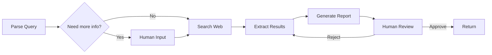

# Part 6: `agentcore-graph` — Workflow Orchestration Engine

## Purpose

Complex agent tasks require more than a single linear loop. They need branching (if this, do that), parallelism (search multiple sources simultaneously), human-in-the-loop gates (pause for approval), error recovery (if tool fails, try alternative), and multi-agent coordination (researcher passes results to reviewer).

The graph package provides a DAG (Directed Acyclic Graph) execution engine for orchestrating complex agent workflows. Each node is an operation (tool call, agent step, human interaction) and edges define data flow and control flow.

## Architecture

```
Graph
├── Node: operation unit (tool call, agent, human gate, transform)
│   ├── input_schema: expected input format
│   ├── output_schema: guaranteed output format
│   └── execute(input) → output
│
├── Edge: data/control flow between nodes
│   ├── from → to
│   ├── condition: optional conditional routing
│   └── transform: optional data transformation
│
├── State: shared state across nodes
│   ├── checkpointing: save/restore at any point
│   └── compensation: rollback on failure
│
└── Executor: runs the graph
    ├── Sequential: one node at a time
    ├── Parallel: independent nodes concurrently
    ├── Dynamic: next node determined by condition
    └── Adaptive: strategy chosen by runtime metrics
```

## Component Breakdown

### 1. `Graph` and `Node` Definitions

**File:** `agentcore/graph/graph.py`

```python
@dataclass
class Node:
    name: str
    description: str
    fn: Callable[[State], Awaitable[Any]]  # The actual operation
    input_schema: dict | None = None              # JSON Schema for input validation
    output_schema: dict | None = None             # JSON Schema for output validation
    timeout: float = 60.0                         # Node execution timeout
    retry_policy: RetryPolicy | None = None       # Retry configuration
    compensation: Callable[[State], Awaitable[None]] | None = None  # Rollback action
    metadata: dict = field(default_factory=dict)

@dataclass
class Edge:
    from_node: str
    to_node: str
    condition: Callable[[State], bool] | None = None   # Conditional routing
    transform: Callable[[Any], Any] | None = None      # Data transformation
    priority: int = 0                                   # Edge priority for sorting

class Graph:
    def __init__(self, name: str = "workflow"):
        self.nodes: dict[str, Node] = {}
        self.edges: list[Edge] = []
    
    def add_node(self, node: Node) -> "Graph": ...
    def add_edge(self, edge: Edge) -> "Graph": ...
    def add_edge_by_name(self, from_name: str, to_name: str, **kwargs) -> "Graph": ...
    
    def get_input_nodes(self) -> list[Node]: ...
    def get_output_nodes(self) -> list[Node]: ...
    def get_downstream(self, node_name: str) -> list[Node]: ...
    def get_upstream(self, node_name: str) -> list[Node]: ...
    
    def topological_sort(self) -> list[Node]: ...
    
    def visualize(self) -> str:  # Returns Mermaid diagram
        ...
```

**Node Types:**

| Node Type | Description | Example |
|-----------|-------------|---------|
| `ToolNode` | Execute a tool from the tool registry | web_search, calculator |
| `AgentNode` | Run an agent loop (sub-graph) | ResearcherAgent on a sub-task |
| `TransformNode` | Transform data (filter, map, aggregate) | Extract key findings from search results |
| `GateNode` | Branch logic: condition → route to next node | If confidence < 0.7, route to SearchNode |
| `HumanInputNode` | Pause, wait for human input | "Review this output and approve/reject" |
| `SubGraphNode` | Execute a nested graph | Complex sub-routine |

---

### 2. State Management

**File:** `agentcore/graph/state.py`

**Purpose:** Manage shared state across nodes. State carries all data produced during workflow execution and supports checkpointing, compensation, and serialization.

```python
@dataclass
class State:
    workflow_name: str
    run_id: str                          # Unique execution ID
    inputs: dict[str, Any]               # Initial inputs
    outputs: dict[str, Any]              # Node outputs: {node_name: output}
    errors: dict[str, str]              # Node errors: {node_name: error_message}
    metadata: dict[str, Any]             # Execution metadata
    
    # Checkpointing
    checkpoints: dict[str, "State"]      # {checkpoint_name: state_snapshot}
    execution_order: list[str]           # Nodes executed in order
    
    # Compensation
    compensated_nodes: set[str]          # Nodes that have been compensated
    
    def set_output(self, node_name: str, output: Any) -> None: ...
    def get_output(self, node_name: str) -> Any: ...
    def has_error(self, node_name: str) -> bool: ...
    
    def checkpoint(self, name: str) -> None: ...
    def restore(self, name: str) -> None: ...
    
    def serialize(self) -> bytes: ...
    @classmethod
    def deserialize(cls, data: bytes) -> "State": ...
```

**Checkpointing:**
- Automatic: checkpoint after each node execution (configurable)
- Manual: `state.checkpoint("before_human_review")`
- Used for: recovery from failure, replay, debugging, human-in-the-loop pause/resume

**Compensation (Saga Pattern):**
- Each node can define a `compensation` function that reverses its effects
- If any node fails, previously executed nodes are compensated in reverse order
- Example: if "ChargeCustomer" succeeds but "SendEmail" fails, compensate by refunding the charge

---

### 3. Graph Executor

**File:** `agentcore/graph/executor.py`

**Purpose:** Execute a graph according to its topology, managing parallelism, error handling, and state.

```python
class GraphExecutor:
    def __init__(self, graph: Graph, strategy: ExecutionStrategy = "auto"):
        self.graph = graph
        self.strategy = strategy  # "sequential", "parallel", "dynamic", "auto"
    
    async def execute(
        self,
        inputs: dict[str, Any],
        callbacks: list[ExecutionCallback] | None = None,
    ) -> ExecutionResult:
        state = State(
            workflow_name=self.graph.name,
            run_id=generate_uuid(),
            inputs=inputs,
        )
        
        execution_order = self._determine_order(state)
        
        for node_name in execution_order:
            node = self.graph.nodes[node_name]
            
            # Check conditions on incoming edges
            if not self._should_execute(node_name, state):
                continue
            
            # Execute node
            try:
                input_data = self._prepare_input(node_name, state)
                output = await self._execute_with_retry(node, input_data)
                state.set_output(node_name, output)
            except Exception as e:
                state.errors[node_name] = str(e)
                await self._compensate(state, node_name)
                raise WorkflowError(f"Node {node_name} failed: {e}")
            
            # Auto-checkpoint
            state.checkpoint(node_name)
        
        return ExecutionResult(
            workflow_name=self.graph.name,
            success=len(state.errors) == 0,
            outputs=state.outputs,
            errors=state.errors,
            duration_ms=...,
            run_id=state.run_id,
        )
```

**Execution Strategies:**

| Strategy | Behavior | Use Case |
|----------|----------|----------|
| `Sequential` | One node at a time, topological order | Simple linear workflows |
| `Parallel` | Run independent nodes concurrently | Fan-out search, parallel tool calls |
| `Dynamic` | Next node chosen by edge conditions | Conditional branching |
| `Adaptive` | Monitor runtime metrics, choose strategy per region | Complex, dynamic workflows |

---

### 4. Human-in-the-Loop

**File:** `agentcore/graph/human.py`

**Purpose:** Provide patterns for incorporating human input into automated workflows. Humans can approve, reject, edit, or provide input at designated gate points.

```python
class HumanInputNode(Node):
    def __init__(
        self,
        name: str,
        prompt_template: str,       # What to ask the human
        input_schema: dict,         # What data to show the human
        output_schema: dict,        # What decision the human makes
        timeout: float = 3600.0,    # How long to wait (1 hour default)
        on_timeout: str = "auto_approve",  # "auto_approve", "auto_reject", "fail"
        notification: dict | None = None,  # Slack/email notification config
    ):
        ...
```

**Human-in-the-Loop Patterns:**

1. **Approval Gate:** Pause before critical action (e.g., "Approve charge of $500?")
2. **Review Gate:** Human reviews agent output before it's sent to user
3. **Correction Gate:** Human can correct/improve agent output
4. **Input Request:** Agent asks human for missing information
5. **Escalation:** Agent fails → human takes over → returns to agent

**Implementation:**
- State is serialized to a persistent store (SQLite/Redis)
- A notification is sent via the configured channel (Slack, email, console)
- The executor polls for human response (or uses webhook)
- On timeout, the configured fallback action is taken

---

### 5. Error Handling and Compensation

**File:** `agentcore/graph/errors.py`

**Saga Pattern Implementation:**

```python
class SagaManager:
    def __init__(self, graph: Graph):
        self.graph = graph
    
    async def compensate(self, state: State, failed_node: str) -> None:
        """Compensate all nodes executed before the failed one, in reverse order."""
        executed = state.execution_order[:]
        executed.reverse()
        
        for node_name in executed:
            if node_name == failed_node:
                break
            if node_name in state.compensated_nodes:
                continue
            
            node = self.graph.nodes[node_name]
            if node.compensation:
                try:
                    await node.compensation(state)
                    state.compensated_nodes.add(node_name)
                except Exception as e:
                    logger.error(f"Compensation for {node_name} failed: {e}")
                    # Continue compensating other nodes — partial compensation
```

**Error Recovery Strategies:**
1. **Retry:** Retry the failed node with backoff
2. **Fallback:** Execute an alternative node (e.g., use cache instead of search)
3. **Skip:** Skip the failed node if it's non-critical
4. **Compensate + Fail:** Compensate all executed nodes and fail the workflow
5. **Human Escalation:** Ask a human to handle the failure

---

### 6. Subgraph Support

**File:** `agentcore/graph/subgraph.py`

**Purpose:** Allow graphs to contain subgraphs (nested workflows). This enables composition of complex workflows from reusable sub-routines.

```python
class SubGraphNode(Node):
    def __init__(self, name: str, subgraph: Graph):
        self.subgraph = subgraph
        super().__init__(
            name=name,
            fn=self._execute_subgraph,
            description=f"Subgraph: {subgraph.name}",
        )
    
    async def _execute_subgraph(self, state: State) -> Any:
        executor = GraphExecutor(self.subgraph)
        result = await executor.execute(state.get_output(self.name))
        return result.outputs
```

---

### 7. Visualization

**File:** `agentcore/graph/visualize.py`

**Purpose:** Generate visual representations of graphs for documentation, debugging, and presentation.

```python
class GraphVisualizer:
    def to_mermaid(self, graph: Graph, highlights: dict[str, str] | None = None) -> str:
        """Generate Mermaid.js flowchart"""
    
    def to_dot(self, graph: Graph) -> str:
        """Generate Graphviz DOT format"""
    
    def to_ascii(self, graph: Graph) -> str:
        """Generate ASCII art for CLI"""
    
    def to_html(self, graph: Graph, state: State | None = None) -> str:
        """Interactive HTML with execution state overlay"""
```

**Mermaid Example:**


---

## Example Workflow: Autonomous Research

```python
research_graph = Graph(name="autonomous_research")

# Nodes
research_graph.add_node(Node("parse_query", "Extract entities and constraints from query", parse_query_fn))
research_graph.add_node(Node("search_web", "Search web for information", search_web_fn))
research_graph.add_node(Node("search_docs", "Search internal documentation", search_docs_fn))
research_graph.add_node(Node("synthesize", "Combine search results into coherent answer", synthesize_fn))
research_graph.add_node(Node("review", "Review output for accuracy and completeness", review_fn))
research_graph.add_node(HumanInputNode("human_review", "Review the final output", timeout=3600))
research_graph.add_node(Node("finalize", "Format and return the final answer", finalize_fn))

# Edges (parallel search, conditional review)
research_graph.add_edge_by_name("parse_query", "search_web")
research_graph.add_edge_by_name("parse_query", "search_docs")
research_graph.add_edge_by_name("search_web", "synthesize")
research_graph.add_edge_by_name("search_docs", "synthesize")
research_graph.add_edge_by_name("synthesize", "review")

# Conditional: if review passes confidence threshold, skip human
research_graph.add_edge(Edge(
    from_node="review", to_node="finalize",
    condition=lambda s: s.get_output("review")["confidence"] >= 0.8
))
research_graph.add_edge(Edge(
    from_node="review", to_node="human_review",
    condition=lambda s: s.get_output("review")["confidence"] < 0.8
))
research_graph.add_edge_by_name("human_review", "finalize")
```

## Testing Strategy

| Test | Description |
|------|-------------|
| `test_topological_sort` | Output respects edge dependencies |
| `test_parallel_execution` | Independent nodes execute concurrently |
| `test_conditional_branching` | Correct branch taken based on condition |
| `test_human_in_loop` | Pauses at HumanInputNode, resumes with input |
| `test_compensation` | Failed node triggers compensation in reverse order |
| `test_checkpoint_restore` | Restore from checkpoint produces same state |
| `test_subgraph` | Subgraph executes and returns correct outputs |
| `test_timeout` | Node timeout triggers fallback |

## Blog Content Angles

- "Building a DAG-Based Workflow Engine for Multi-Agent Systems"
- "Human-in-the-Loop Patterns: Approval, Review, Correction, and Escalation"
- "The Saga Pattern in AI Workflows: Compensating Failed Operations"
- "Conditional Branching in Agent Orchestration: If-Else for AI"
- "Checkpointing and Recovery: Making Agent Workflows Resilient"

## File Structure

```
packages/python/graph/
├── __init__.py
├── graph.py                # Graph, Node, Edge
├── state.py                # State, checkpointing
├── executor.py             # GraphExecutor, ExecutionResult
├── strategies.py           # Sequential, Parallel, Dynamic, Adaptive
├── human.py                # HumanInputNode
├── errors.py               # WorkflowError, SagaManager
├── subgraph.py             # SubGraphNode
├── visualize.py            # GraphVisualizer
├── nodes/
│   ├── __init__.py
│   ├── tool_node.py        # ToolNode
│   ├── agent_node.py       # AgentNode
│   ├── transform_node.py   # TransformNode
│   ├── gate_node.py        # GateNode
│   └── subgraph_node.py    # SubGraphNode
└── tests/
    ├── test_graph.py
    ├── test_executor.py
    ├── test_human.py
    └── test_saga.py
```
