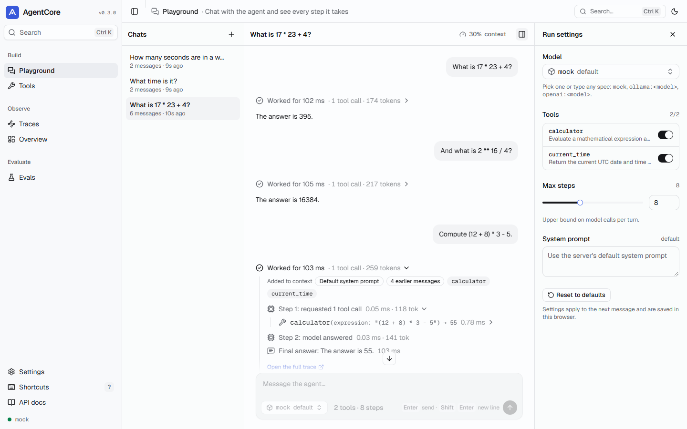

AgentCore is an **agentic AI platform written from scratch in plain Python**. It contains the
pieces a production agent system needs, each implemented in readable code instead of wrapped
from a framework:

- a **ReAct runtime** with native tool calling, streaming, memory and guard rails,
- a **tool framework** that turns typed Python functions into validated JSON-Schema tools,
- an **evaluation harness** with trajectory matching, LLM-as-judge, record/replay and regression gates,
- **RAG** with BM25 + dense hybrid search and verified citations,
- **vector indexes** (Flat, HNSW, IVF, scalar and product quantization) written with numpy,
- a **workflow-graph engine** with checkpoints, human-in-the-loop and saga compensation,
- **multi-agent** collaboration over an in-process message bus,
- **observability**: spans, metrics, structured logs and cost tracking,
- a **web app and HTTP API** (`agentcore serve`), including an OpenAI-compatible endpoint.

The runtime dependencies are `httpx`, `numpy` and `pyyaml`. There is no LangChain, LangGraph,
AutoGen or CrewAI underneath.

## Offline by default

Everything runs **without a model server**. A deterministic, rule-based `mock` model drives the
examples, the test suite and CI, so you can try every feature on a laptop with no API key. When
you are ready, point the same code at a local model through [Ollama](/agentcore/docs/models/) or at
any OpenAI-compatible server by changing one string: `mock`, `ollama:<model>` or `openai:<model>`.

## Where to start

| If you want to... | Read |
|---|---|
| Install the package or run the container | [Installation](/agentcore/docs/installation/) |
| See it working in two minutes, no model needed | [Quickstart](/agentcore/docs/quickstart/) |
| Start your own agent project | [New project: `agentcore init`](/agentcore/docs/project/) |
| Understand how the modules fit together | [Concepts](/agentcore/docs/concepts/) |
| Use the web app (chat, traces, evals, overview) | [Web app](/agentcore/docs/web-app/) |
| Call it over HTTP or from an OpenAI client | [HTTP API](/agentcore/docs/reference/http-api/) |
| Run it on a server | [Deployment](/agentcore/docs/deployment/) |

## Project status

AgentCore is beta software (version 0.3.0). The APIs described in these docs are the ones in the
repository and are covered by its test suite, but they may still change between minor versions;
the [changelog](/agentcore/docs/changelog/) lists every change. It is a single-user, local-first
system: sessions and eval history live in JSON files, traces in JSONL files. There are no user
accounts or database.
