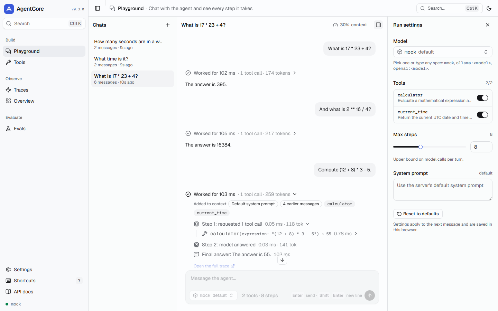
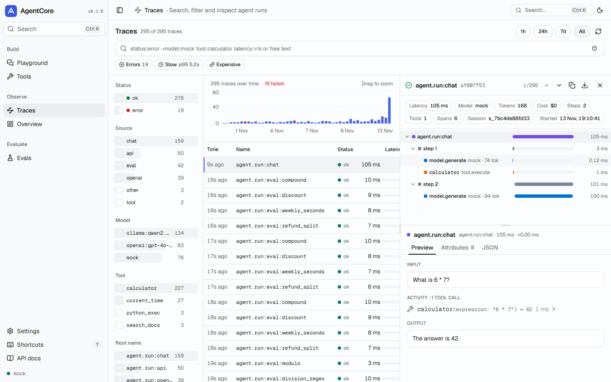
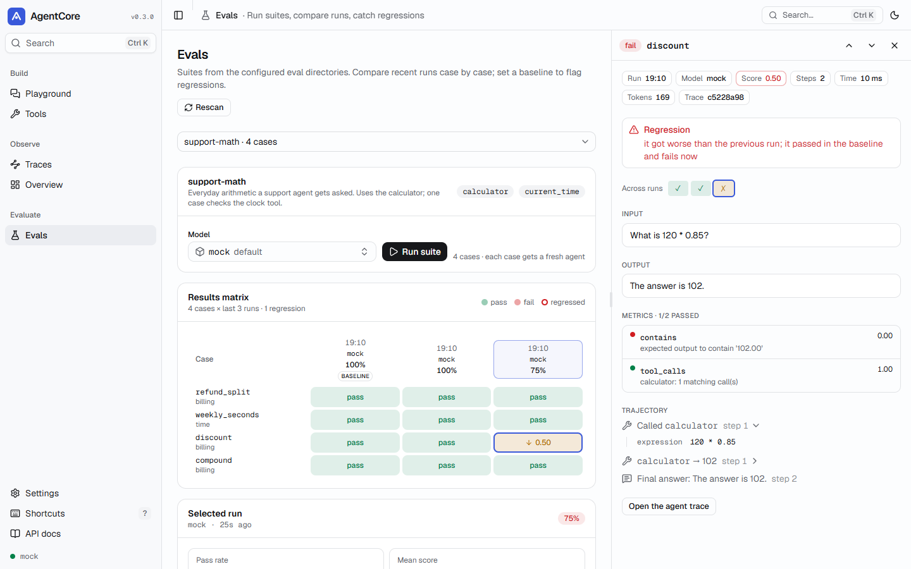
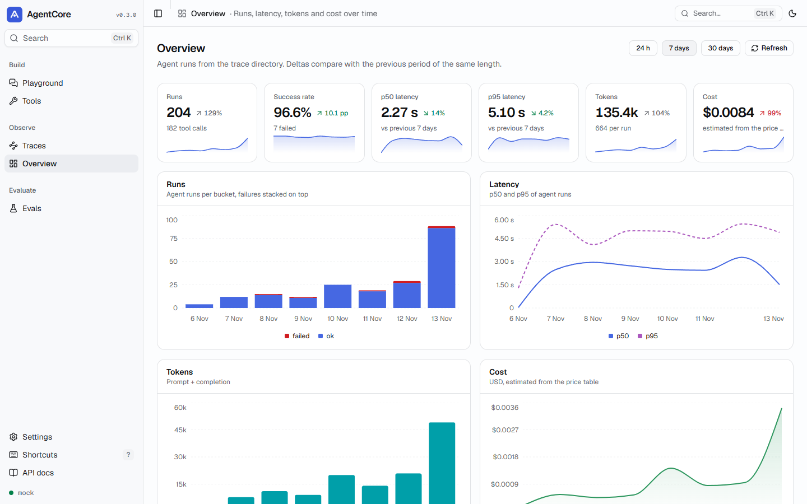
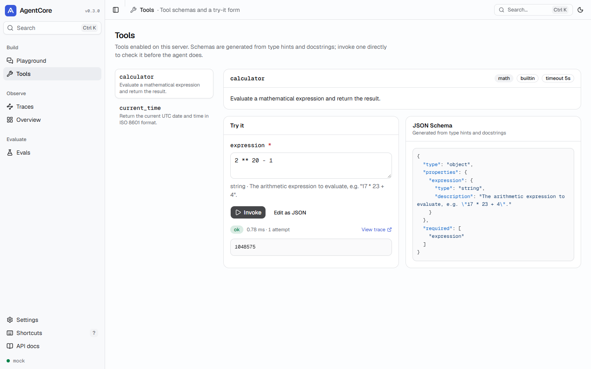
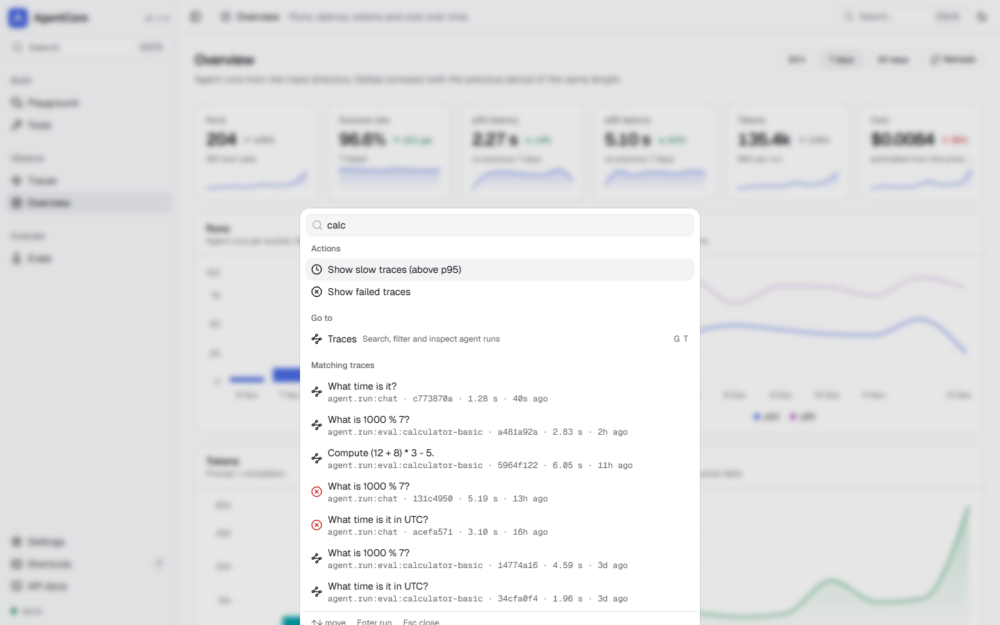
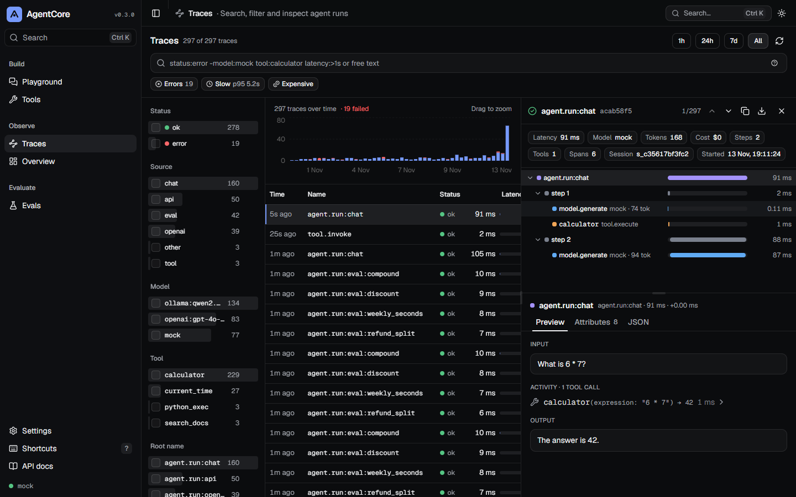
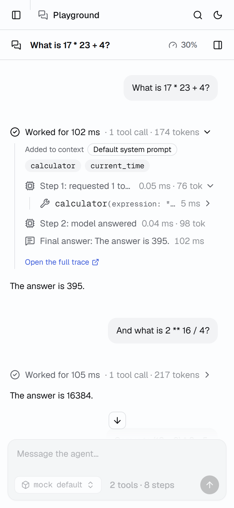

`agentcore serve` serves a web app next to the HTTP API. It is a React application (Vite, React
19, TypeScript, Tailwind CSS v4, shadcn/ui on Radix primitives) that is **pre-built into the Python
package**, so it needs no Node.js at runtime and loads no CDN scripts or remote fonts.

```bash
agentcore serve --model mock     # http://127.0.0.1:8000
```

:::note[About the screenshots]
The screenshots on this page show **sample data**: the offline mock model plus generated sample
traces (including Ollama- and OpenAI-style runs) so the charts have shape. Your dashboard shows
your own runs.
:::

## Playground



A multi-turn chat streamed over Server-Sent Events, with sessions stored on the server.

- **Run summary.** Each reply starts with "Worked for 102 ms · 1 tool call · 174 tokens". Expand it
  for the step timeline: what was added to the model's context (system prompt, earlier messages,
  tools), each model call with latency and tokens, the model's reasoning before a tool call, and
  every tool call with its arguments and result. Failures show the error with its stack frames.
- **Run settings** (`.` toggles the panel): model, tool switches, max steps and system prompt.
  Settings are saved in the browser and apply to the next message.
- **Model picker.** Lists the server default, `models` from `agentcore.toml`, `mock` and any
  Ollama models it finds; you can also type any spec such as `openai:<model>`.
- **Context** meter: how much of the 10-turn memory window the chat uses, and the tokens and
  estimated cost so far.
- **Stop** cancels the running turn on the server. Every reply links to its trace and can be
  copied. Chats can be deleted (with undo).

## Traces



An explorer for every run in the trace directory:

- **Query bar** with the [trace query language](/agentcore/docs/reference/query-language/) and
  autocomplete (fields first, then values with counts). Parsed clauses appear as removable pills.
- **Quick filters**: Errors, Slow (above the current p95) and Expensive (top 10% by cost, or by
  tokens when no model is priced). They insert plain clauses, so nothing is hidden.
- **Facet sidebar** with per-value counts for status, source, model, tool and root name. Counts for
  a field ignore that field's own clauses, so after picking `status:error` you still see how many
  `ok` traces there are. Check a value to include it, use the minus button to exclude it.
- **Histogram** of trace volume with failures stacked on top; drag across it to zoom into a time
  range. Preset ranges: 1h, 24h, 7d, All.
- **Table** sorted on the server by time, name, status, latency, tokens, cost or model.
- **Side peek** (resizable; a full-screen sheet on phones): metadata pills, a nested span tree with
  latency bars, and **Preview / Attributes / JSON** tabs for the selected span. Preview renders the
  model's input messages and output, tool calls and results, nested subagent runs and the final
  answer. Copy the id or export the trace as JSON.

Everything is in the URL: `/traces/<id>?query=status:error&range=24h&tab=1` reopens the same list,
filters and peek.

## Evals



- Suites are discovered in `eval_dirs` (default `evals/` and `examples/evals/`). With none, a
  **Create starter suite** button writes a three-case calculator suite to `evals/starter.yaml`.
- **Run suite** with any model; the run executes in the background with a progress bar and a queue
  of the cases left and done.
- The **results matrix** shows cases x the last 10 completed runs (oldest on the left). A cell is
  outlined when the case got worse than in the previous run or fails where the baseline passed.
  Arrow keys move between cells; Enter opens the **case peek** with the input, output, each metric,
  the recorded trajectory, the same case across runs and a link to its agent trace.
- The selected run shows pass rate, mean score, tokens and agent time, a comparison with the
  baseline, and per-case results. **Set baseline** in the run history marks the run later runs are
  compared against.

## Overview



KPI cards for runs, success rate, p50 and p95 latency, tokens and cost, each with a sparkline and
the change against the previous period of the same length (green when it is better, red when it is
worse). Charts over 24 h, 7 or 30 days for runs (failures stacked), latency p50/p95, tokens and
cost; top tools with call counts and error rates (each links to its traces); models; and recent
failures.

## Tools



Every tool enabled on the server with its description, category, timeout and JSON Schema, plus a
form generated from the schema (or raw JSON) to invoke it directly. Tools that run code, write files
or make network requests ask for confirmation first. Each invocation is traced (`tool.invoke`).

## Settings

Theme (system, light, dark), the API key stored in this browser, a reset for view preferences, and
the server's effective configuration (version, config file, default model, tools, directories, auth,
CORS, body limit). The server never returns secrets.

## Keyboard and command palette



`Ctrl/Cmd+K` opens the command palette: go to any view, start a new chat, toggle the theme, open a
recent or matching trace, reopen a chat, or run an eval suite. `?` lists every shortcut.

| Keys | Action |
|---|---|
| `Ctrl/Cmd+K` | Command palette |
| `?` | Keyboard shortcuts |
| `G` then `P` / `T` / `E` / `O` / `L` / `S` | Playground, Traces, Evals, Overview, Tools, Settings |
| `N` | New chat |
| `Shift+T` | Toggle light / dark |
| `Ctrl/Cmd+B` | Collapse the sidebar |
| `/` | Focus the main input (composer or query bar) |
| `.` | Show / hide run settings (Playground) |
| `J` / `K`, `Enter`, `Esc` | Next / previous trace, open, close the peek |
| `1` `2` `3` | Peek tabs: Preview, Attributes, JSON |
| `R` | Refresh traces |
| Arrow keys, `Enter` | Move in the eval matrix, open a case |

## Themes, phones and accessibility





Light and dark themes follow the operating system unless you pick one. At phone width (375 px) the
sidebar, the chat list, the run settings, the trace filters and every side peek become sheets.
Components are built on Radix primitives with visible focus, keyboard navigation in the span tree,
tabs and matrix, and live regions for streamed replies and query errors.

## API key

When the server runs with `AGENTCORE_API_KEY`, the app shell still loads and asks for the key once.
It is kept in the browser's local storage and sent as a bearer token; Settings can change or forget
it. See [Deployment](/agentcore/docs/deployment/#api-key).

## Development

The source is in `web/` in the repository; `pnpm --dir web dev` starts Vite on port 8762 and proxies
the API to `agentcore serve` on port 8761. See [Contributing](/agentcore/docs/contributing/).
